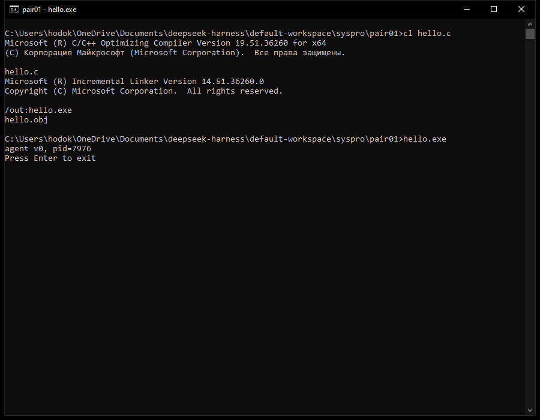
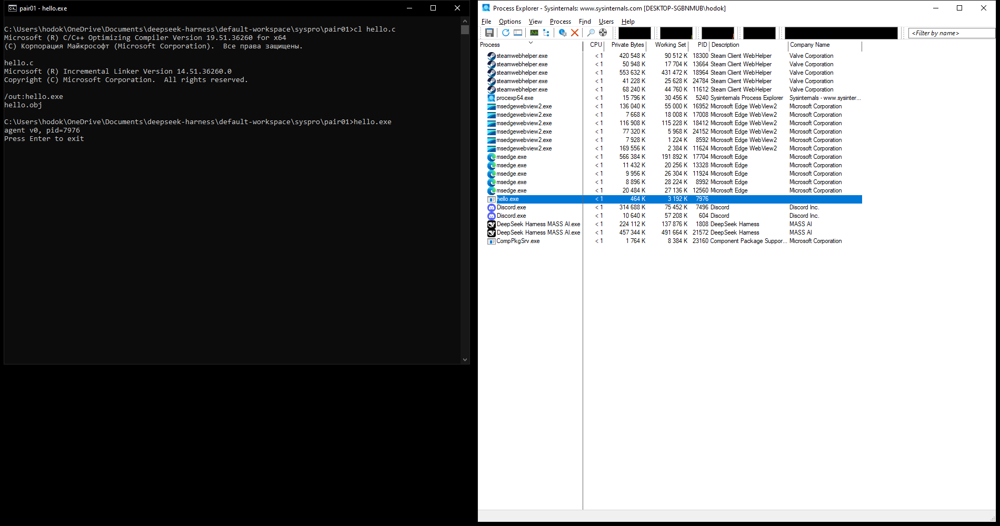
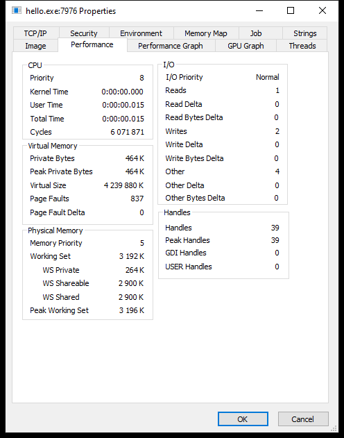
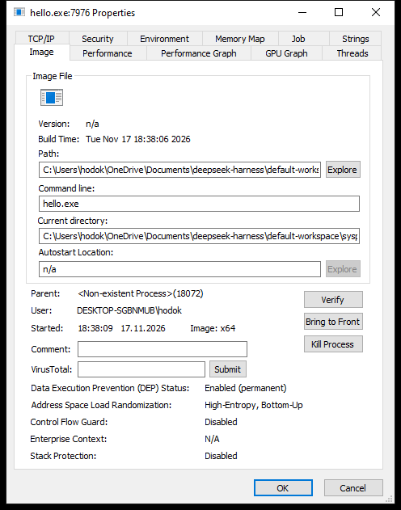
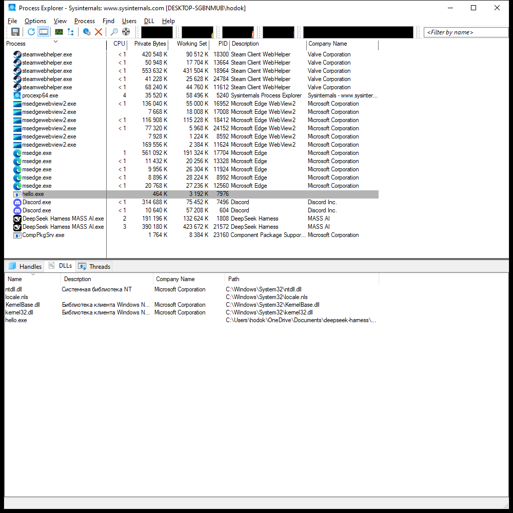
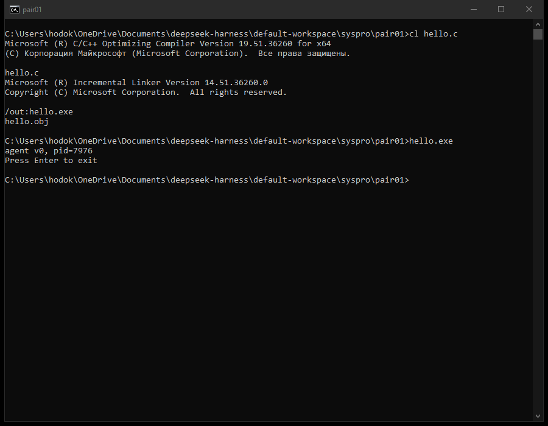
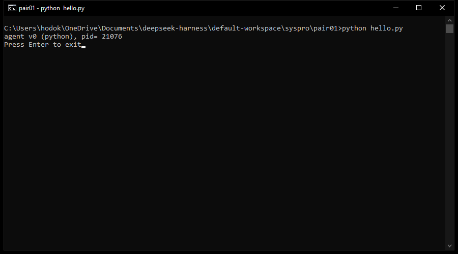
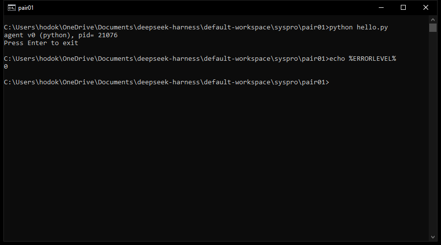

# ЛР 1. Процесс изнутри

Система: `Windows 10 22H2 (build 19045), x64` · компилятор: `Microsoft (R) C/C++ Optimizing Compiler Version 19.51.36260 for x64`

## Программа на C
Программа напечатала PID `7976`, монитор показал PID `7976`.
Память процесса в мониторе: `3 192 КБ (рабочий набор), собственных 464 КБ`. Процессорное время: `0:00:00.015`.
Пока программа ждёт Enter, процессорное время не растёт, потому что `getchar() делает системный вызов чтения, и ядро переводит процесс в состояние ожидания (Waiting/Sleeping) — процессор ему больше не выделяется`.
Дескрипторов у процесса: `39`. Ввод и вывод ведут в `устройство консоли \Device\ConDrv`.
Системные библиотеки в процессе: `ntdll.dll, kernel32.dll, KernelBase.dll (и locale.nls)`.
После завершения из монитора терминал напечатал `сразу приглашение, без сообщения об ошибке`, код завершения `1`.

## Программа на Python
Имя процесса в мониторе: `python.exe`, PID `21076`, память `≈ 12 500 КБ`.
Памяти больше, чем у программы на C, примерно в `4` раза.
Общая библиотека у программ на C и Python: `ntdll.dll (а также kernel32.dll и KernelBase.dll)`.
Код завершения при обычном выходе: `0`.

Не получилось: `панель Handles в Process Explorer на этой машине остаётся пустой — система запрещает перечисление дескрипторов чужого процесса, поэтому число 39 взято с вкладки Performance свойств процесса, а снимок 4 — вкладка Image (путь к файлу, текущая папка, родитель cmd.exe).`
ИИ: `использовал — оформление и подготовка команд сделаны с помощью ИИ-ассистента`.

## Снимки экрана

Сохраните снимок поверх заглушки в папке `screenshots/` с тем же именем — ссылки ниже менять не нужно.

### 1. Программа на C запущена
Шаг 1. Видно: команда сборки и строка `agent v0, pid=…` в терминале.

### 2. Свой процесс в мониторе
Шаг 3. Видно: строка процесса `hello.exe` с тем же номером, что напечатала программа.

### 3. Свойства процесса
Шаг 4. Видно: окно процесса `hello.exe`: номер, память, процессорное время, дескрипторы.

### 4. Дескрипторы процесса
Шаг 5. Видно: путь к файлу, текущая папка процесса и его родитель (вкладка Image).

### 5. Библиотеки процесса
Шаг 6. Видно: загруженные библиотеки процесса.

### 6. Процесс завершён из монитора
Шаг 8. Видно: терминал после завершения: сразу приглашение и код завершения `1`.

### 7. Программа на Python в мониторе
Шаг 9. Видно: строка `agent v0 (python), pid=…`.

### 8. Обычный выход
Шаг 11. Видно: терминал после Enter: код завершения `0`.

