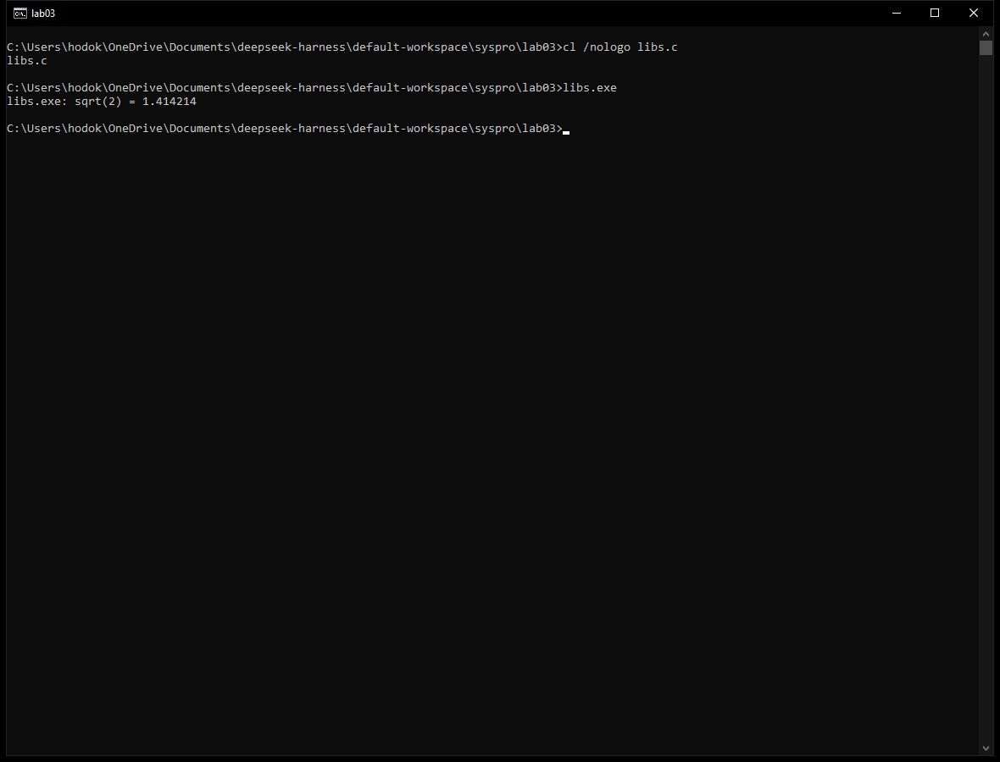
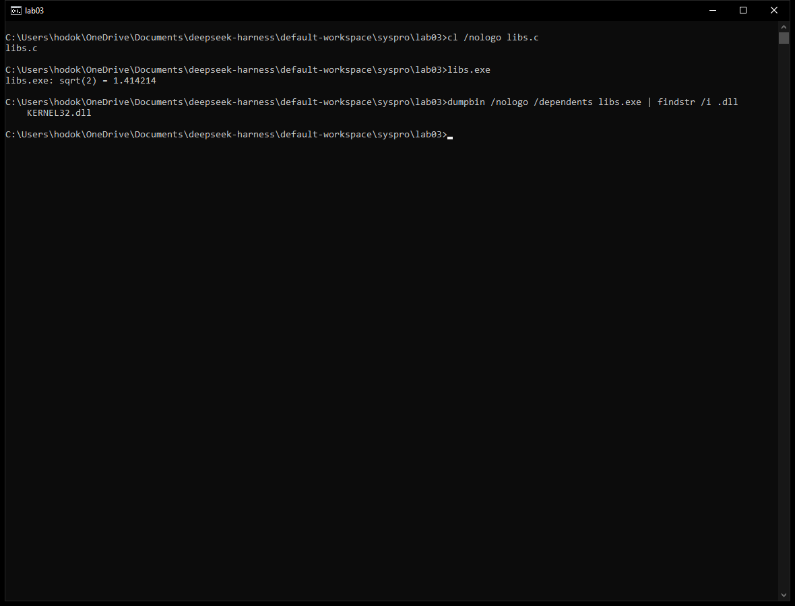
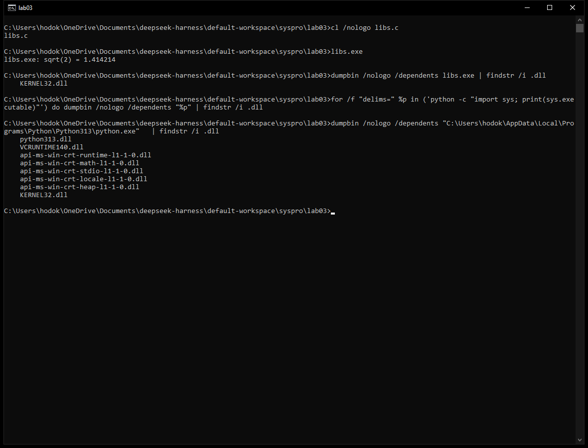
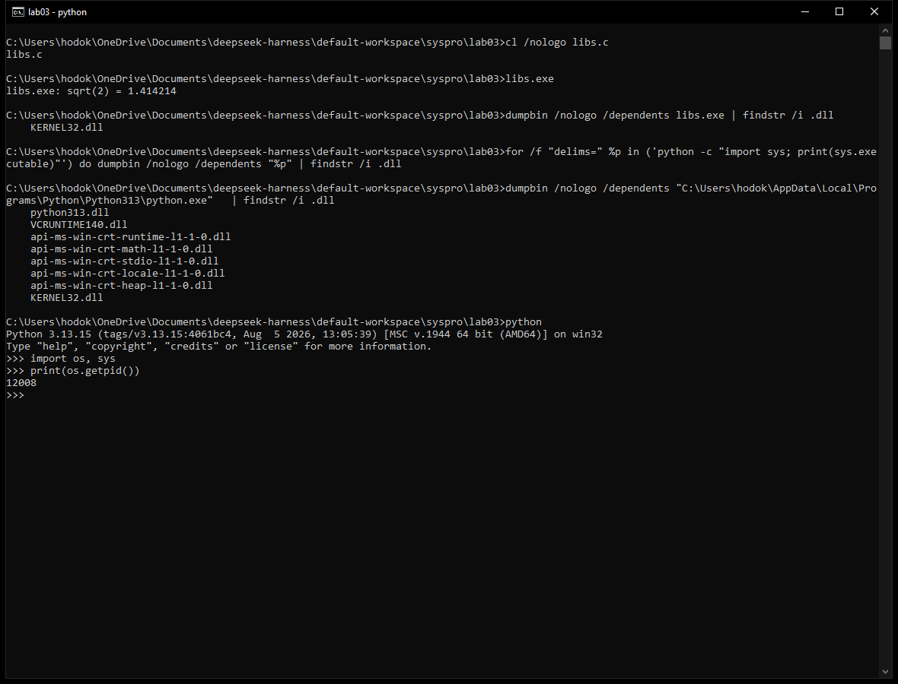
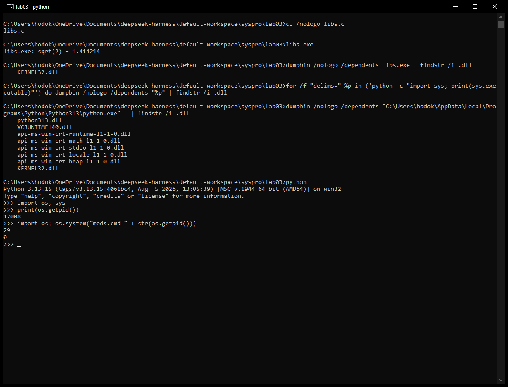
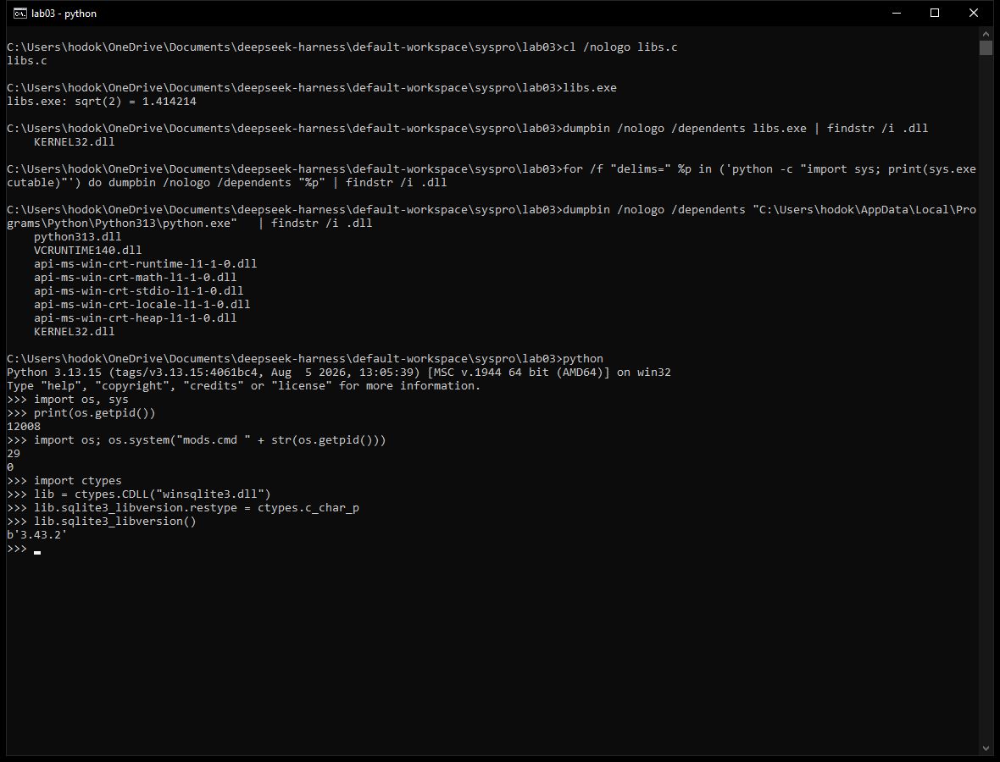
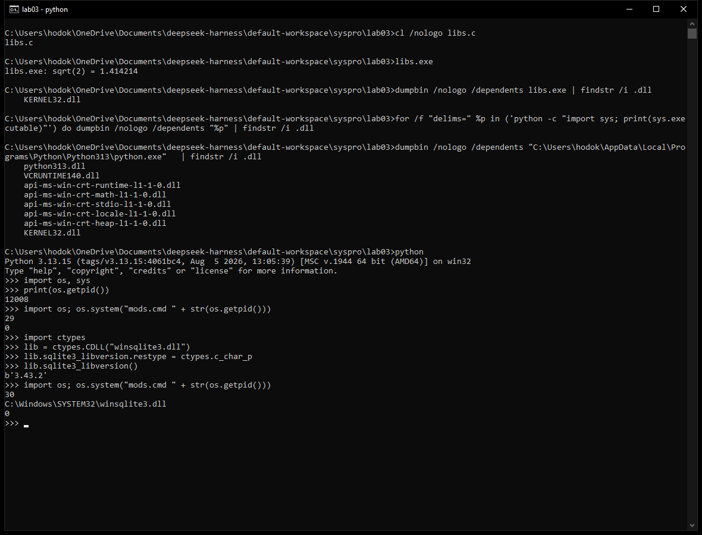

# ЛР 3. Библиотеки программы

Система: `Windows 10 22H2 (build 19045), x64`

## Библиотеки файла
Программа напечатала: `libs.exe: sqrt(2) = 1.414214`
Команда для списка библиотек файла: `dumpbin /nologo /dependents libs.exe | findstr /i .dll`
Библиотеки libs: `KERNEL32.dll`
Почему в списке нет отдельной математической библиотеки (или почему она есть): `компилятор MSVC по умолчанию компонует библиотеку C статически: нужные функции (sqrt, printf) попадают внутрь .exe, а отдельной математической библиотеки libm в Windows нет`.
Где лежит интерпретатор Python (файл или библиотека): `python313.dll` (рядом с python.exe; на сайте курса пример для python314.dll).

## Библиотеки процесса
PID Python: `12008`
Библиотек в процессе до ctypes.CDLL: `29`, после: `30`
Загруженная библиотека и её полный путь: `winsqlite3.dll — C:\Windows\System32\winsqlite3.dll`
Функция вернула: `b'3.43.2'`

Не получилось: `tasklist /m на этой машине отвечает «Отказано в доступе» (ограничение прав окружения), поэтому загрузку библиотеки проверял по списку модулей процесса: число модулей было 29, после ctypes.CDLL стало 30, и в списке появился C:\Windows\System32\winsqlite3.dll — это видно на снимках 5 и 7.`
ИИ: `использовал — оформление и подготовка команд сделаны с помощью ИИ-ассистента`.

## Снимки экрана

Сохраните снимок поверх заглушки в папке `screenshots/` с тем же именем — ссылки ниже менять не нужно.

### 1. Сборка и запуск
Шаг 1. Видно: команда сборки и строка `sqrt(2) = 1.414214`.

### 2. Библиотеки файла libs
Шаг 2. Видно: вывод `dumpbin /dependents` для своей программы.

### 3. Библиотеки интерпретатора Python
Шаг 3. Видно: тот же вывод для файла Python.

### 4. Номер процесса Python
Шаг 4. Видно: запущенный Python и его номер процесса.

### 5. Библиотеки процесса до загрузки
Шаг 5. Видно: число библиотек процесса Python до `ctypes.CDLL` (29) и отсутствие winsqlite3.dll.

### 6. Библиотека загружена
Шаг 6. Видно: строка `ctypes.CDLL` и результат вызова функции библиотеки.

### 7. Библиотеки процесса после загрузки
Шаг 7. Видно: новое число библиотек (30) и полный путь загруженной библиотеки.

