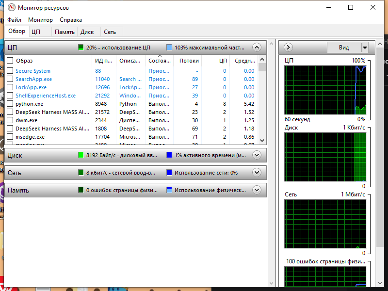
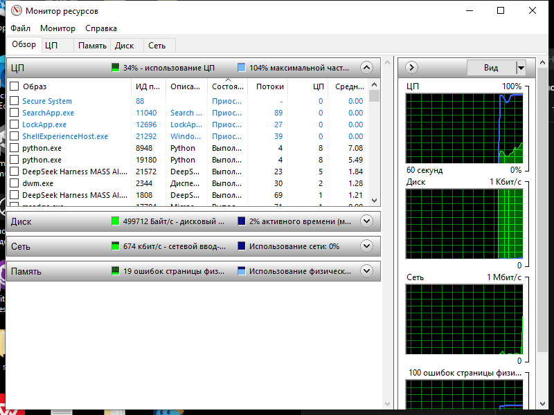
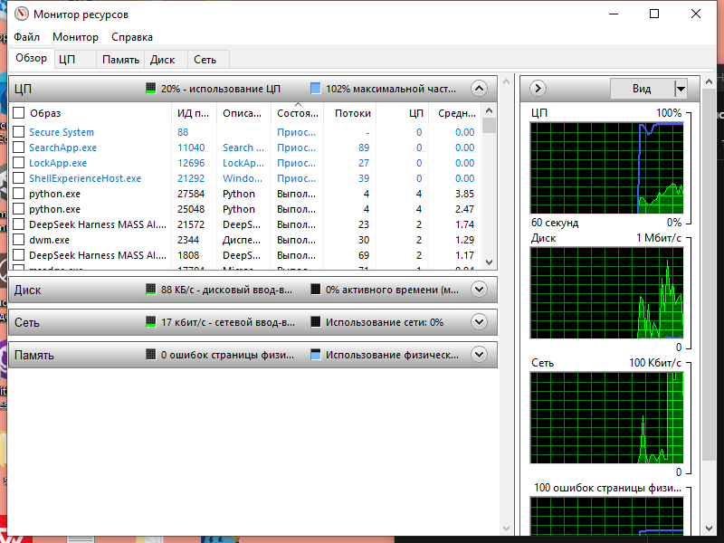
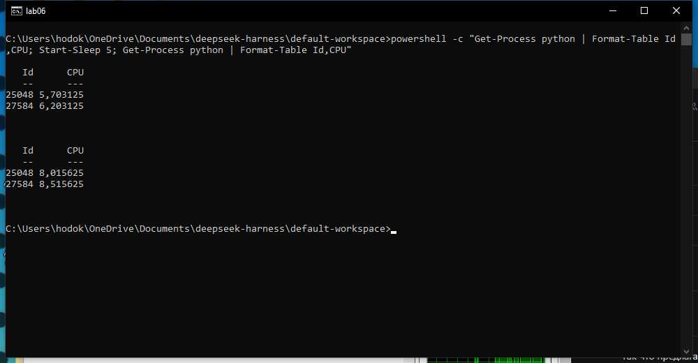

# ЛР 6. Кто загружает процессор

Система: `Windows 10 22H2 (build 19045), x64`
Ядер (логических процессоров): `12`

## Одна нагрузка
Процент процесса в мониторе: `8,00 % (одно ядро из 12 занято целиком)`.
Общая загрузка: `20 % — из них 8 % даёт Python, остальное фоновая работа программ (браузер, Discord, сам монитор)`.
На каких ядрах видна нагрузка: `на всех понемногу: планировщик переносит процесс с ядра на ядро, ровной полосы 100 % ни на одном ядре нет`.

## Две нагрузки
Проценты обеих нагрузок и общая загрузка: `8,00 % и 5,49 %, общая загрузка 34 %`.
На одном ядре (в macOS — фоновый режим): `по 3,85 % и 2,47 % (ядро делится пополам), общая загрузка 20 %`.

## Процессорное время
Первый замер, второй замер, пауза: `5,70 с → 8,02 с и 6,20 с → 8,52 с, пауза 5 с`.
Загрузка по замерам: `(8,02 − 5,70) / 5 = 0,46, то есть 46 % одного ядра (процесс делит ядро с другим таким же)`.
Почему процент в мониторе не говорит о скорости работы: `процент — это доля времени, в течение которого ядро было занято. Ядра бывают разной частоты и разного энергосбережения, поэтому те же 100 % дают разное количество работы; по проценту нельзя сказать, сколько полезного программа успела сделать`.

Не получилось: `— (на этом ПК в фоне работают браузер и Discord, поэтому общая загрузка выше, чем на кадрах сайта)`.
ИИ: `использовал — оформление и подготовка команд сделаны с помощью ИИ-ассистента`.

## Снимки экрана

Сохраните снимок поверх заглушки в папке `screenshots/` с тем же именем — ссылки ниже менять не нужно.

### 1. Одна нагрузка
Шаг 1. Видно: процесс Python в мониторе: его процент и общая загрузка.

### 2. Две нагрузки
Шаг 3. Видно: два процесса Python и загрузка ядер.

### 3. Нагрузки на одном ядре
Шаг 4. Видно: две нагрузки на одном ядре и их проценты.

### 4. Процессорное время
Шаг 5. Видно: два замера процессорного времени с паузой между ними.

