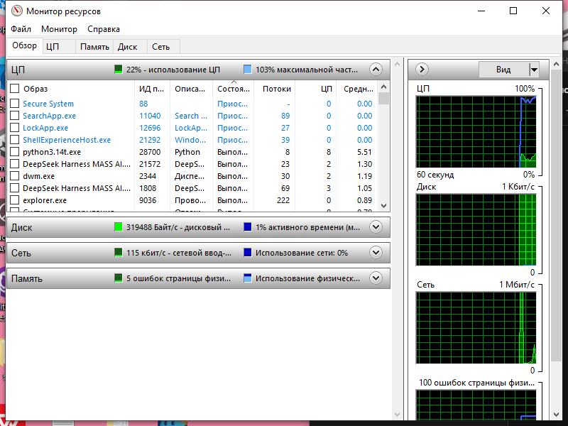
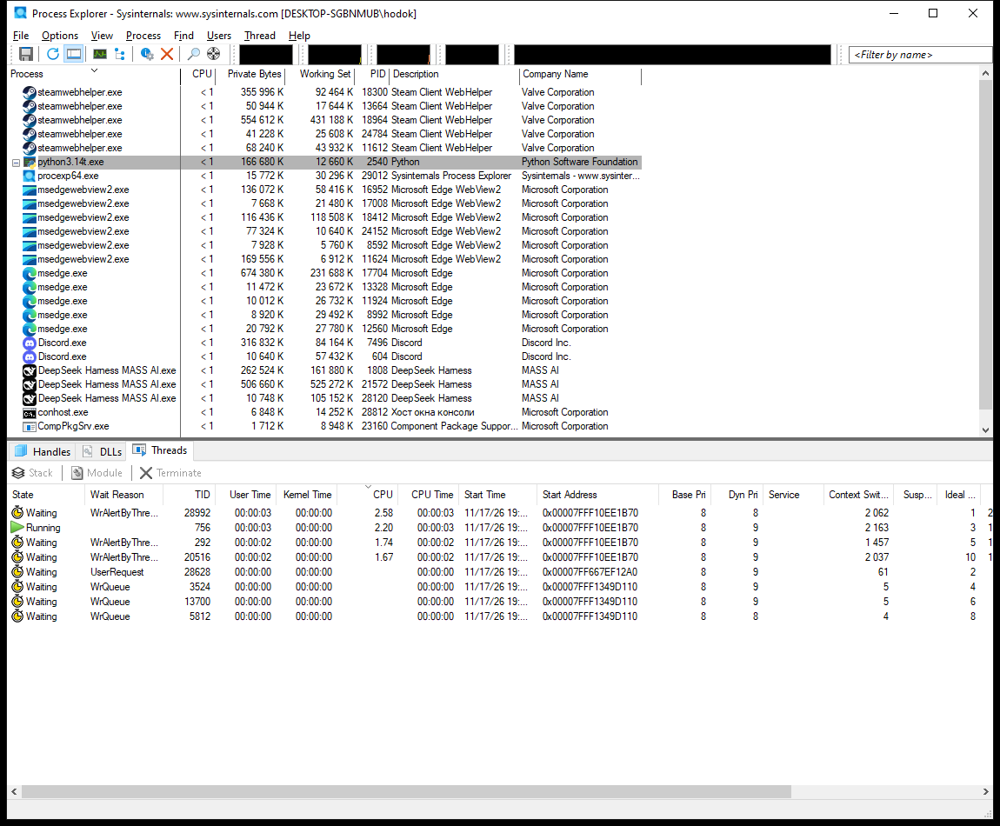
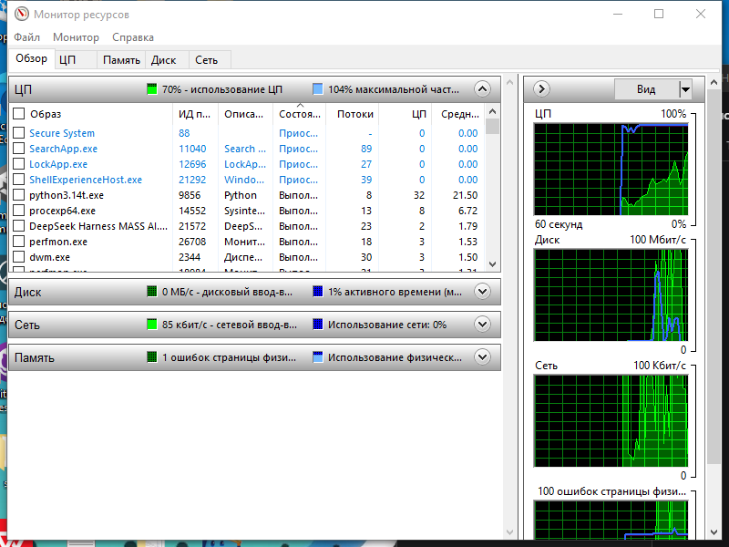
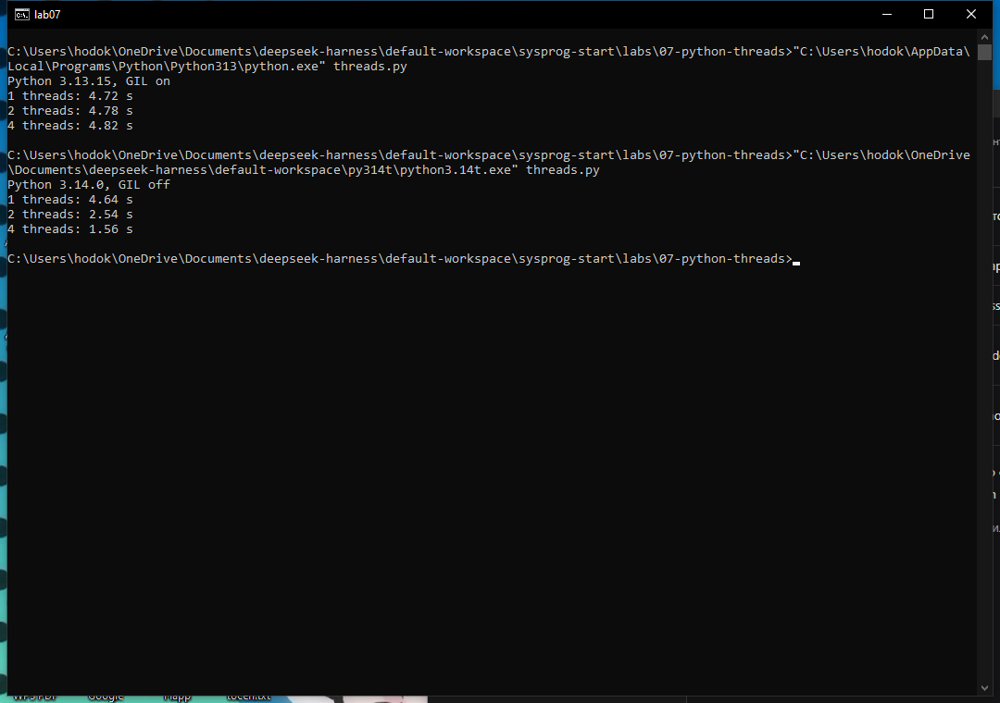

# ЛР 7. Потоки Python и GIL

Система: `Windows 10 22H2 (build 19045), x64`
Ядер (логических процессоров): `12`
Версии Python (обычный и без GIL): `Python 3.13.15 (обычный, GIL включён) и Python 3.14.0 free-threaded — python3.14t.exe (GIL выключен)`

## Python с GIL
Процент процесса и число потоков: `5,51 % в момент снимка (около одного ядра из 12; на графике 8 %), потоков 8 — четыре рабочих потока программы и служебные потоки интерпретатора`.
Сколько потоков выполняется одновременно: `один: в списке потоков состояние Running у одного, остальные в состоянии Wait — GIL пропускает к счётчику команд только один поток`.

## Python без GIL
Процент процесса и проценты потоков: `33,40 % — это четыре ядра из 12; в списке потоков четыре рабочих потока одновременно в состоянии Running, у каждого около 8 % (одно ядро)`.

## Время работы
С GIL, 1 / 2 / 4 потока: `4,41 с · 5,56 с · 4,41 с (обычный Python 3.13 — ускорения нет, иногда даже медленнее из-за переключений)`.
Без GIL, 1 / 2 / 4 потока: `4,30 с · 2,31 с · 1,33 с (Python 3.14t — время уменьшается почти пропорционально числу потоков)`.
Без GIL с PYTHON_GIL=1: `4,26 с · 4,25 с · 4,51 с — переменная окружения снова включает GIL, и ускорение исчезает`.
Ожидание, 1 и 4 потока: `2,00 с и 2,00 с — ожидающие потоки ускоряются и с GIL`.
Почему ожидающие потоки ускоряются и с GIL: `поток в time.sleep() отпускает GIL и не занимает процессор, поэтому все четыре ожидания идут одновременно; GIL ограничивает только вычисления, но не ожидание`.

Не получилось: `— (для свободного от GIL режима скачана официальная сборка python-3.14.0t-amd64 с python.org и запускалась из своей папки)`.
ИИ: `использовал — оформление и подготовка команд сделаны с помощью ИИ-ассистента`.

## Снимки экрана

Сохраните снимок поверх заглушки в папке `screenshots/` с тем же именем — ссылки ниже менять не нужно.

### 1. Четыре потока с GIL
Шаг 1. Видно: процесс Python в мониторе: его процент и число потоков.

### 2. Потоки процесса
Шаг 2. Видно: список потоков процесса: сколько выполняется, сколько ждёт.

### 3. Четыре потока без GIL
Шаг 3. Видно: процесс python3.14t в мониторе: его процент и загруженные ядра.

### 4. Время работы
Шаг 4. Видно: вывод threads.py в Python с GIL, без GIL и с PYTHON_GIL=1, а также wait.py.

