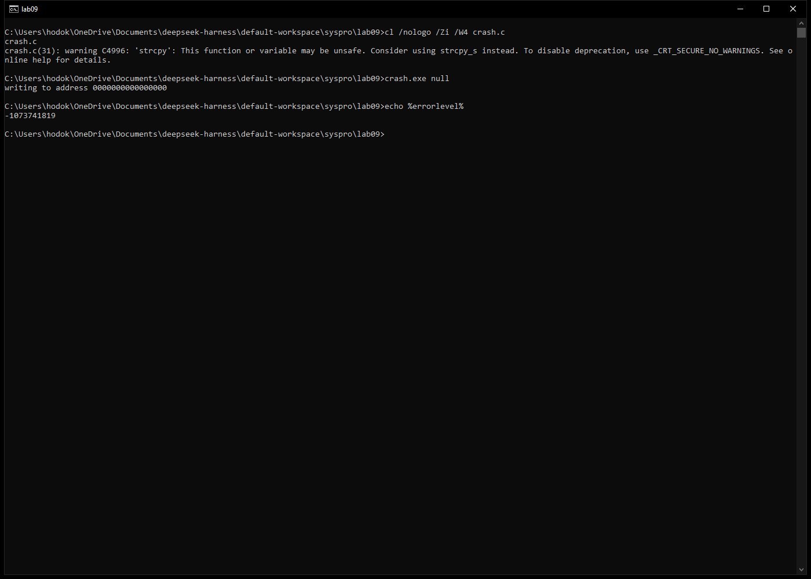
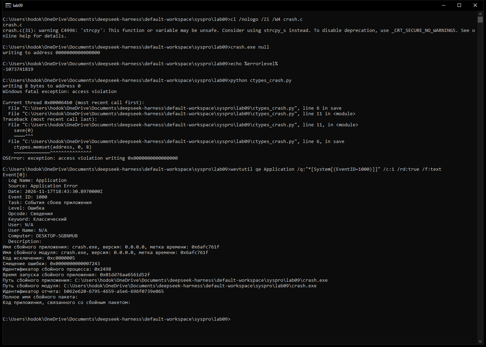
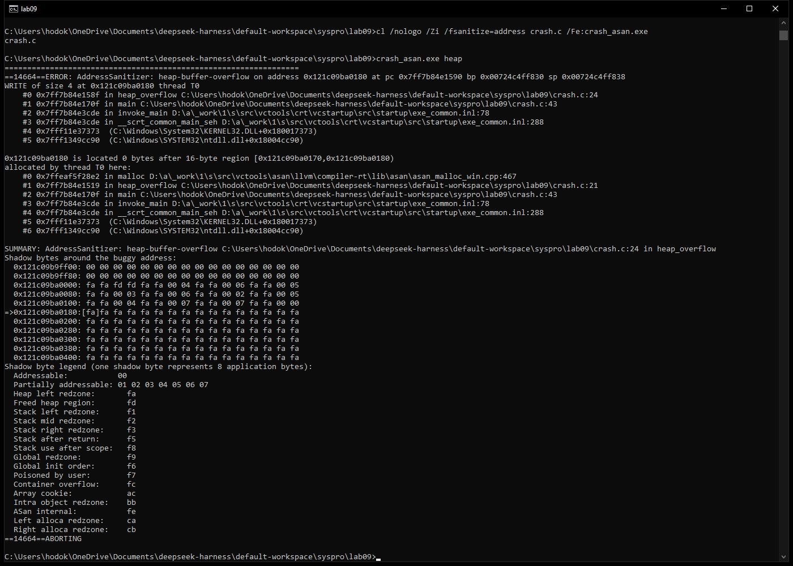
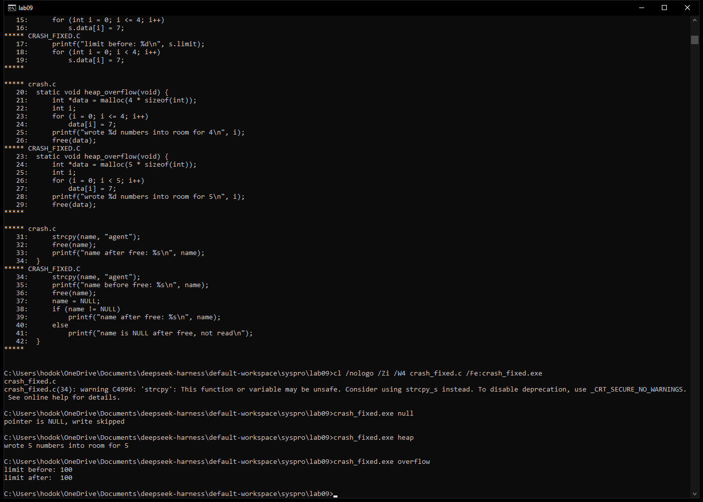

# ЛР 9. Разбор падения

Система: `Windows 10 22H2 (build 19045), x64`
Компилятор: `Microsoft (R) C/C++ Optimizing Compiler Version 19.51.36260 for x64`

## Падение
crash null: что напечатано и код завершения: `напечатано «writing to address 0000000000000000», код завершения -1073741819 (0xC0000005 — нарушение доступа)`.
ctypes_crash.py: что напечатал Python: `«writing 8 bytes to address 0», затем «Windows fatal exception: access violation», трассировка Python (файл ctypes_crash.py, строки 6 и 11) и «OSError: exception: access violation writing 0x0000000000000000»`.
Где система записала падение: `в журнале «Приложение» (Просмотр событий → Журнал приложений), источник «Application Error», код события 1000: сбойный модуль crash.exe, код исключения 0xc0000005, смещение 0x0000000000007243`.

## Молчаливые ошибки
crash overflow: limit до и после, код: `limit до 100, после 7 (запись за границу массива затёрла поле limit), код завершения 0`.
crash heap без проверки: `напечатано «wrote 5 numbers into room for 4», программа не упала, код завершения 0 — ошибка прошла молча`.
AddressSanitizer для heap: вид ошибки и строка: `heap-buffer-overflow, WRITE of size 4, строка crash.c:24 (функция heap_overflow), в отчёте также указана строка выделения crash.c:21`.
AddressSanitizer для uaf: вид ошибки и две строки: `heap-use-after-free (READ of size 2); память освобождена в строке crash.c:32 (free(name)), прочитана в строке crash.c:33 (printf "name after free: %s", name)`.

## Исправление
Что изменено и что напечатала исправленная программа: `в crash_fixed.c добавлены проверки: указатель проверяется на NULL перед записью, циклы идут до i < 4 и i < 5 в пределах выделенного размера, после free указатель обнуляется и освобождённая память не читается. Исправленная программа напечатала: «pointer is NULL, write skipped» (null), «wrote 5 numbers into room for 5» (heap), «limit before: 100 / limit after: 100» (overflow) — все три с кодом 0 и без падений.`

Не получилось: `— (всё получилось; AddressSanitizer в MSVC 19.51 на x64 работает, отчёт печатается)`.
ИИ: `использовал — оформление, тексты и подготовка команд сделаны с помощью ИИ-ассистента`.

## Снимки экрана

Сохраните снимок поверх заглушки в папке `screenshots/` с тем же именем — ссылки ниже менять не нужно.

### 1. Падение
Шаг 1. Видно: запуск crash null и код завершения.

### 2. Падение Python
Шаг 2. Видно: вывод ctypes_crash.py и запись системы о падении.

### 3. Отчёт AddressSanitizer
Шаг 4. Видно: отчёт AddressSanitizer о переполнении буфера в куче.

### 4. Исправление
Шаг 6. Видно: разница файлов crash.c и crash_fixed.c и вывод исправленной программы.

